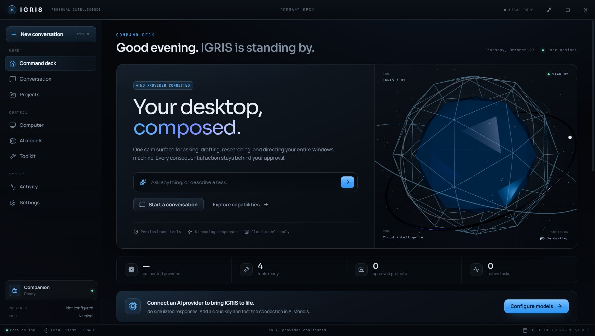
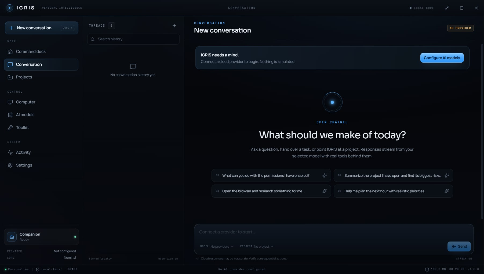
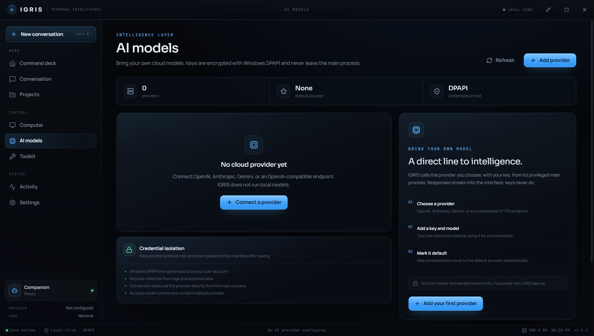
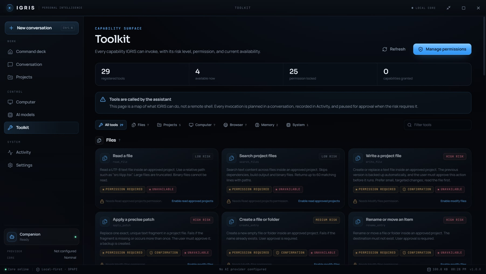
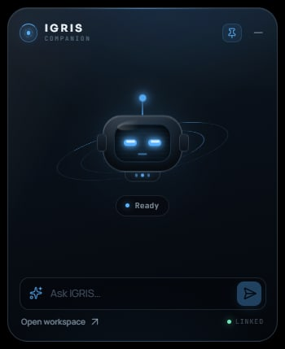

# IGRIS

**A premium personal AI assistant for Windows.** One calm, three-dimensional surface for asking, researching, writing code, and directing your machine — with every consequential action held behind explicit permission and approval.

IGRIS is a native Electron application with a React interface, real cloud-model streaming, a local SQLite history, a small robot launcher that appears when the workspace is minimized, and a permissioned tool runtime for files, terminals, applications, real screen vision, voice input, and web handoff, with web pages handed to your default browser.



> **Cloud intelligence only.** IGRIS does not ship a local model, does not silently fall back to one, and never fabricates an assistant response when no provider is configured. Add your own OpenAI, Anthropic, Gemini, OpenRouter, OpenCode Console, or OpenAI-compatible key.

---

## Highlights

- **Immersive conversation core** — obsidian, titanium, and electric-azure design with a procedural 3D core in the Conversation view, graceful CSS fallback, and three accent identities.
- **Genuine streaming chat** — SSE streaming from cloud providers, persistent conversations, cancellation, usage metadata, and provider-aware error messages.
- **22 permissioned tools** — project inspection, file read/search/write/patch, checkpoints, allowlisted terminal commands, app launch, real screen vision, browser handoff, voice transcription, and memory.
- **Approval by design** — sensitive tools require a granted capability *and* a per-call confirmation. High-risk tools are marked, logged, and time-limited.
- **See my screen** — real desktop vision: when you ask, IGRIS captures your whole desktop exactly as you see it (including background windows like the browser or VS Code) and attaches the image to the model so it can actually look.
- **Voice input** — hold the microphone in the Conversation composer; speech is transcribed by your cloud provider (Gemini inline audio today) and sent into the chat as if you typed it. Mic access is gated by the `Voice input` permission.
- **Hands off your browser** — web pages open in Chrome, Edge, or whatever Windows uses, directly to the site you named. IGRIS never embeds a browser and cannot read, click, or fill those pages.
- **Local-first persistence** — conversations, tasks, tool runs, memories, logs, and settings live in a local SQLite database.
- **Windows DPAPI credentials** — provider keys are encrypted with Electron `safeStorage`, used only in the privileged main process, and never sent back to the interface.
- **Auditable activity** — every task, step, tool call, approval, and result appears in Activity, with diagnostic export.



## What IGRIS is not

- Not a local-model runner. Ollama and bundled models are intentionally out of scope.
- Not a trading or financial automation tool.
- Not an autonomous agent that bypasses confirmations. The model proposes; you decide.
- Not a hosted service. Your history stays on this PC; prompts go only to the provider you configure.

---

## Quick start

### Requirements

- Windows 10 or 11 (x64)
- Node.js 22 or newer (developed on Node 24)
- npm 10 or newer
- A cloud provider API key

### Run from source

```powershell
npm install
npm run dev
```

`npm install` runs `node node_modules/electron/install.js` in `postinstall` to guarantee the Electron 45 binary is present.

### Build the Windows installer

```powershell
npm run dist
```

Output: `release/IGRIS-1.0.0-x64-Setup.exe` (NSIS, per-user install, selectable directory).

The installer is **unsigned** because no code-signing certificate is configured. Windows SmartScreen may warn until the binary is signed.

### Connect a provider

1. Open **AI models**.
2. Choose **Add provider** and select OpenAI, Anthropic, Google Gemini, OpenRouter Free, OpenCode Console, or an OpenAI-compatible endpoint.
3. Enter a display name, optional base URL, API key, and model ID.
4. Use **Test connection** to verify the key and model before relying on it.
5. Save. The first provider becomes the default; additional providers can be promoted in one click.

Keys are encrypted with Windows DPAPI in the main process. After saving, the interface receives only a masked hint such as `••••abcd`. API usage is billed by the provider, not by IGRIS.

### OpenRouter Free

OpenRouter offers a rotating catalogue of free models through an OpenAI-compatible API. Create a key at [openrouter.ai/keys](https://openrouter.ai/keys) and choose **OpenRouter Free**.

- The base URL is locked to `https://openrouter.ai/api/v1`.
- **Fetch** lists only models whose IDs end in `:free`. IGRIS rejects paid IDs when saving, testing, or starting a chat.
- No OpenRouter credits are needed for `:free` models, but they are rate-limited.
- Some free models require enabling prompt logging in your OpenRouter privacy settings.
- The free catalogue rotates. If a model disappears or is throttled, fetch again and choose another `:free` model.

### OpenCode Console

OpenCode Console is a model gateway: one `oc_sk_...` key reaches Claude, GPT, Gemini, and open coding models. Create a personal key in the [OpenCode Console](https://opencode.ai/console) and choose **OpenCode Console** in IGRIS.

- Pay-as-you-go base URL: `https://opencode.ai/inference/openai/v1`
- Go base URL: `https://opencode.ai/inference/go/openai/v1` (IGRIS sends the stable `x-opencode-session` header Go requires)
- Good coding defaults: `claude-sonnet-5-5` or `gpt-6.1-sol`; cheaper alternatives include `glm-5.3` and `deepseek-v4.1-flash`
- **Fetch** lists only paid models. OpenCode's free-tier models are restricted to OpenCode and return HTTP 403 from other clients.
- The Console account must have credits or an active Go plan; otherwise requests fail with a clear insufficient-funds error.



---

## Permissions

Every capability is off by default. Enable only what you need in **Settings → Permissions**.

| Permission | What it unlocks | Default |
| --- | --- | --- |
| Read approved projects | List, preview, search files inside folders you add | Off |
| Modify files | Create, edit, patch, rename, move, delete with backups | Off |
| Coding agent actions | Checkpoints and project test runs | Off |
| Run terminal commands | Allowlisted development commands inside a project | Off |
| Launch applications | Start apps from a fixed, verified list | Off |
| Web browsing | Open pages and searches in your default browser | Off |
| See my screen | Look at your whole desktop (background windows included) when you ask | Off |
| Voice input | Transcribe microphone speech with your cloud provider | Off |

Sensitive actions still require a per-call confirmation by default (`Settings → Intelligence → Confirm sensitive actions`). File writes create a backup; deletes go to the Windows Recycle Bin where possible; terminal commands run without a shell and are constrained by an executable allowlist.

### Tool inventory

| Group | Tools |
| --- | --- |
| Projects | `list_projects`, `inspect_project` |
| Files | `read_file`, `search_files`, `write_file`, `apply_patch`, `create_entry`, `rename_entry`, `delete_entry` |
| Code & terminal | `create_checkpoint`, `run_command`, `run_tests` |
| Applications | `list_apps`, `launch_app`, `list_windows` |
| Screen vision | `see_screen` (attaches the captured desktop image to the model) |
| Browser | `browser_open`, `browser_search`, `youtube_search` (hand URLs to the system browser) |
| Memory & system | `save_memory`, `search_memories`, `current_time` |

The model never receives a raw shell. It receives typed tool schemas; the main process validates arguments, checks permissions, applies risk policy, requests approval when needed, enforces timeouts and output caps, and records the run.



---

## The companion

The companion window is retired. IGRIS keeps only the small robot launcher:

- The main window is a normal workspace window.
- Minimizing it hides the workspace UI and shows a compact 112×112 robot bubble on the desktop (always on top, draggable, click to restore).
- There is no separate companion window, tray companion status, or quick-ask surface.



---

## Architecture at a glance

```text
┌───────────────────────────── Renderer (sandboxed) ─────────────────────────────┐
│ React 19 + TypeScript + Vite · Home / Chat / Projects / Computer / Models /    │
│ Tools / Activity / Settings / History · React Three Fiber core                 │
└───────────────────────────────▲────────────────────────────────────────────────┘
                                │ typed contextBridge API (preload)
┌───────────────────────────────┴────────────────────────────────────────────────┐
│ Electron main process                                                          │
│  ProviderService → adapters (OpenAI / Anthropic / Gemini /                     │
│  OpenRouter / OpenCode) · streaming, tool calls, discovery                     │
│  ChatEngine → streaming runs, cancellation, tool loop                          │
│  ToolRuntime → permissions, confirmations, risk, timeouts, audit                │
│  Services → files, terminal, apps, screen, voice, web handoff                │
│  Storage → node:sqlite repositories · CredentialStore (DPAPI) · Logger          │
└────────────────────────────────────────────────────────────────────────────────┘
```

- **Single writer:** all privileged operations, network calls, SQLite access, and secret decryption live in the main process.
- **Typed boundary:** the preload exposes a narrow promise-based API; IPC methods are validated with Zod and role-checked per window.
- **Hardened renderer:** `contextIsolation`, `sandbox`, no Node integration, a restrictive CSP, and no remote module.
- **Deterministic lifecycle:** one app instance, tray-resident shutdown, interrupted-task recovery, and explicit window roles.

Read [docs/ARCHITECTURE.md](docs/ARCHITECTURE.md) for the full walkthrough.

---

## Data locations

IGRIS uses the Electron per-user data directory, normally:

```text
%APPDATA%\IGRIS\
  data\igris.db          SQLite database (including diagnostic events)
  data\backups\          file-write backups
  data\screenshots\      screen visions captured by the assistant
```

Use **Settings → Privacy & data** to export data, clear conversation and memory history, change retention, or disable conversation saving. No telemetry is sent anywhere.

---

## Scripts

| Command | Purpose |
| --- | --- |
| `npm run dev` | Electron + Vite development with HMR |
| `npm run build` | Type-check and build main, preload, renderer, and mini launcher |
| `npm start` | Preview the production build |
| `npm test` | Vitest unit and integration suite |
| `npm run test:e2e` | Build, then run Playwright Electron smoke tests |
| `npm run test:packaged` | Pack, then smoke-test the packaged `IGRIS.exe` |
| `npm run pack` | Unpacked Windows build in `release/win-unpacked` |
| `npm run dist` | NSIS installer in `release/` |
| `npm run visual` | Capture the visual QA screenshot set |
| `npm run icons` | Regenerate application and tray icons |

### Verification status

- `npm run typecheck` — passing
- `npm test` - **79 tests passing** across 10 files
- `npm run test:e2e` - **7 Electron smoke tests passing**
- `npm run test:packaged` — packaged `IGRIS.exe` boots, bridges, and routes
- `npm run pack` — passing (`release/win-unpacked/IGRIS.exe`)
- `npm run dist` — passing (`release/IGRIS-1.0.0-x64-Setup.exe`)

Live provider calls are not part of the automated suite because no API key is committed. The adapters, SSE parser, error mapping, and request building are covered; configure a key to exercise a real stream. Manual verification also exercised OpenRouter's free catalogue and a streamed Gemini `gemini-3.6-flash` reply through the chat engine.

See [docs/TESTING.md](docs/TESTING.md) for details.

---

## Project layout

```text
src/
  main/          Electron main process
    ai/          provider adapters, SSE, HTTP, chat engine
    security/    credentials, path guard, command policy, redaction, errors
    services/    files, terminal, apps, screen, voice, web handoff, provider, settings
    storage/     SQLite database and repositories
    tasks/       task state and orchestration
    tools/       tool registry and runtime
    windows/     main, mini, paths
    ipc.ts       validated dispatcher and role allowlists
    index.ts     boot, lifecycle, wiring
  preload/       contextBridge and type declarations
  renderer/      React application and mini launcher UI
  shared/        types, defaults, settings normalization, IPC contract
tests/
  unit/          pure security, settings, SSE, error, state tests
  integration/   in-memory SQLite repository tests
  e2e/           Playwright Electron smoke tests
docs/            architecture, security, testing, status, screenshots
scripts/         icons and visual QA
```

---

## Security

The security model is documented in [docs/SECURITY.md](docs/SECURITY.md). In brief:

- API keys are encrypted at rest with Windows DPAPI and decrypted only for a provider call.
- The renderer never receives a stored key; the bridge returns masked hints only.
- All filesystem access is confined to explicitly approved workspaces with lexical and real-path checks.
- Terminal commands are parsed without a shell, checked against an executable allowlist, and blocked for destructive git/npm operations.
- Web tools open Chrome/Edge (the system default) and stop there; IGRIS cannot read, click, or fill pages in it.
- Logs and diagnostic exports redact common credential patterns.
- High-risk actions require confirmation and are recorded in Activity.

Please do not open a public issue containing an API key, personal path, or conversation content. See the security document for reporting guidance.

---

## Limitations

- **Windows only** at this time. The UI is responsive, but native window and input paths target Windows.
- **Cloud keys required.** There is no bundled model, no offline inference, and no local fallback.
- **Unsigned installer.** Code signing is intentionally left to the distributor.
- **No keyboard or mouse control.** IGRIS cannot type, click, or drive other applications; it acts through tools only.
- **Screen vision is best effort.** Captures depend on display configuration and the permission being granted; images are attached to the model for the current run only.
- **Web tools only hand off URLs.** IGRIS cannot see, read, or control the default browser, so it cannot bypass site authentication, CAPTCHAs, or anti-bot controls.
- **Live provider behavior varies.** Model IDs, tool-calling support, quotas, and rate limits are controlled by the provider.

## License

MIT © 2026 Samarth. See [LICENSE](LICENSE).
